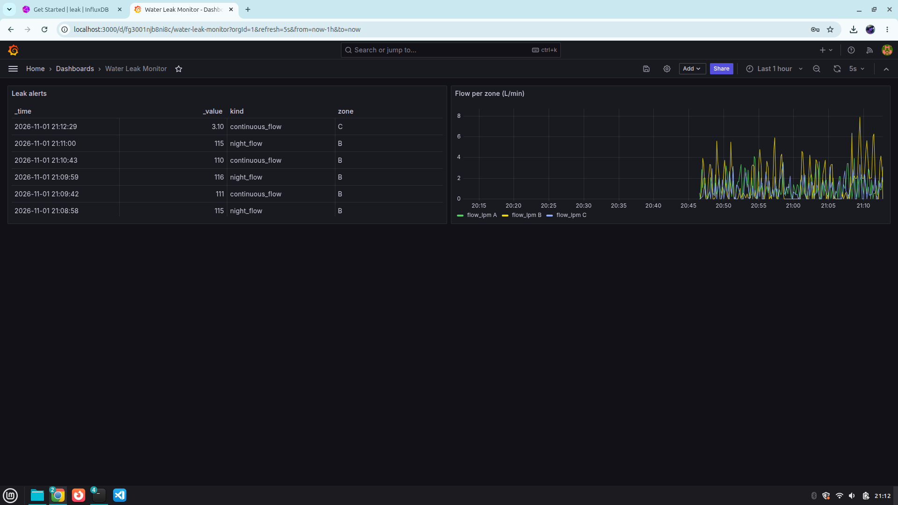
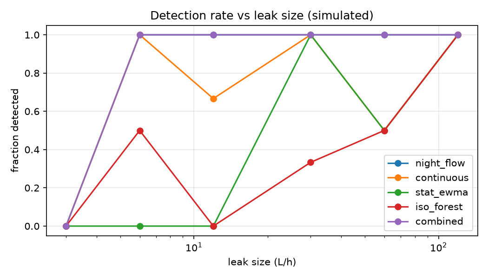

# Water Leak Detection (free, software-only)

Simulated 3-zone building -> detectors -> evaluation -> live MQTT pipeline -> Grafana + Telegram.
Everything here is simulation-based. Results say how the *algorithms* behave, not how real sensors behave.

## Phase 0: setup
```
python -m venv .venv && source .venv/bin/activate      # Windows: .venv\Scripts\activate
pip install -r requirements.txt
git init && git add . && git commit -m "init"
```

## Phase 1: simulate the building
```
python -m sim.simulate
```
Creates `data/train.csv` (56 clean days), `data/test.csv` (56 days with 12 leaks + 2 non-leak high-usage events),
`data/labels.csv` (ground truth), `data/events.csv`. Edit `PLAN`, `EVENTS`, `DEADBAND`, `NOISE` in `sim/simulate.py` to change scenarios.
Optional upgrade: replace `generate()` with a WNTR network (`pip install wntr`) and keep the same CSV columns (ts, A, B, C, main).

## Phase 2: public data
Download BattLeDIM and LeakDB, then:
```
python -m detection.run_external --csv FILE --time-col Timestamp --value-col SENSOR --sep ";" --decimal "," --train-frac 0.5
```
Check the real column names and separators in the files. Compare printed alert times with the dataset's leak start/end list.
These are network-level, 5-min datasets, so thresholds from the simulator will not transfer; the detectors are refit on the training part.

## Phase 3-4: detectors and localization
`detection/rules.py`: continuous-flow, minimum night flow, hour-of-week EWMA, Isolation Forest, persistence checks.
`detection/localize.py`: night-flow excess per zone + mass-balance gap (main minus zone meters) for leaks in unmetered pipe.

## Phase 7: evaluate (do this before the live pipeline)
```
python -m detection.evaluate
```
Prints recall, latency, false alarms/month, smallest detected leak, detection by size, localization accuracy.
Saves `results/summary.csv`, `results/detection_by_size.csv`, `results/per_leak.csv`, `results/detection_vs_size.png`
and writes `data/baseline.json` (night-flow thresholds used by the live backend).

## Phase 5: live pipeline
```
docker compose up -d                                    # Mosquitto, InfluxDB, Grafana
uvicorn backend.app:app --port 8000                     # terminal 1: subscriber + detector + API
python -m publisher.publish --start-day 0 --speed 1440  # terminal 2: replay (1 sim day per real minute)
```
Telegram (optional): create a bot with @BotFather, message it once, open
`https://api.telegram.org/bot<TOKEN>/getUpdates` to find your chat id, then
`export TELEGRAM_TOKEN=... TELEGRAM_CHAT_ID=...` before starting uvicorn. Without them, alerts print to the terminal.
API: `GET /alerts`, `POST /alerts/{id}/false_alarm`, `GET /health`.
The live backend runs the two cheap rules (continuous flow, night flow). Stat/ML detectors run offline in evaluate.

## Phase 6: Grafana
Open http://localhost:3000 (admin/admin), datasource "InfluxDB" is pre-provisioned. Panel queries (Flux):
```
// live flow per zone
from(bucket:"flow") |> range(start: v.timeRangeStart, stop: v.timeRangeStop)
  |> filter(fn:(r)=> r._measurement=="flow" and r._field=="flow_lpm")
  |> aggregateWindow(every: 10s, fn: mean)
// alert history (table panel)
from(bucket:"flow") |> range(start: -1h) |> filter(fn:(r)=> r._measurement=="alert")
```
Panels: flow per zone (time series), alerts (table), alert count per zone (stat; red when > 0).

## Phase 8: package
Screenshot Grafana, record a 60-second demo (replay a leak -> alert), paste `results/summary.csv` and the chart into this README,
and state the limitations: simulated data, zone-level localization, sensor deadband assumption.

## Results (simulated data)




| Method | Leaks detected | Median latency | False alarms/month |
|---|---|---|---|
| night_flow | 11/12 | 15.8 h | 0 |
| continuous | 9/12 | 4.0 h | 1.07 |
| stat_ewma | 5/12 | 41.5 h | 2.14 |
| iso_forest | 4/12 | 4.8 h | 2.68 |
| combined | 11/12 | 4.0 h | 3.21 |

Limitations: simulated data, zone-level localization only, smallest detectable leak 6 L/h
under the simulated sensor settings (readings below 0.05 L/min read as zero).
